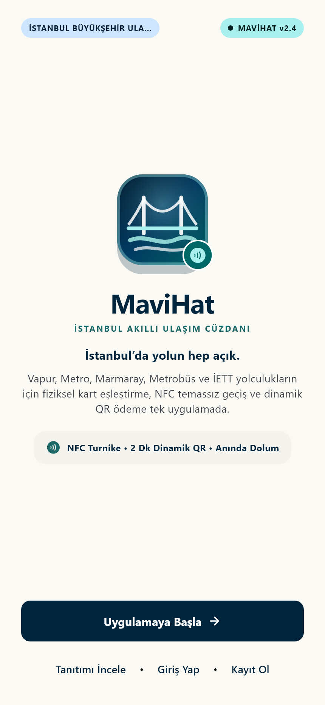
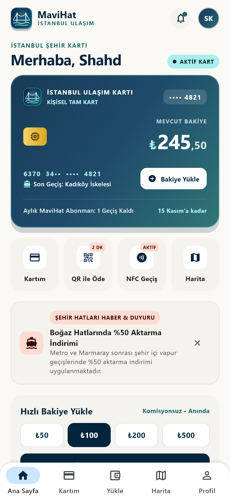
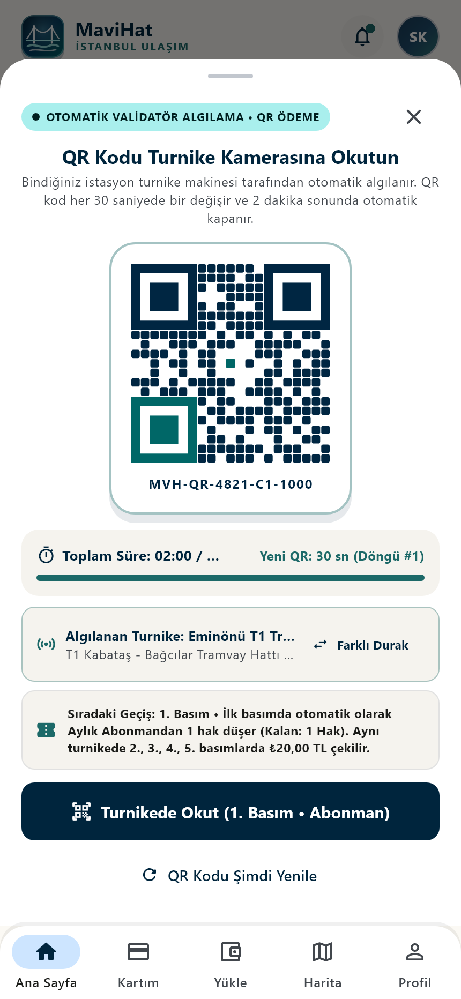
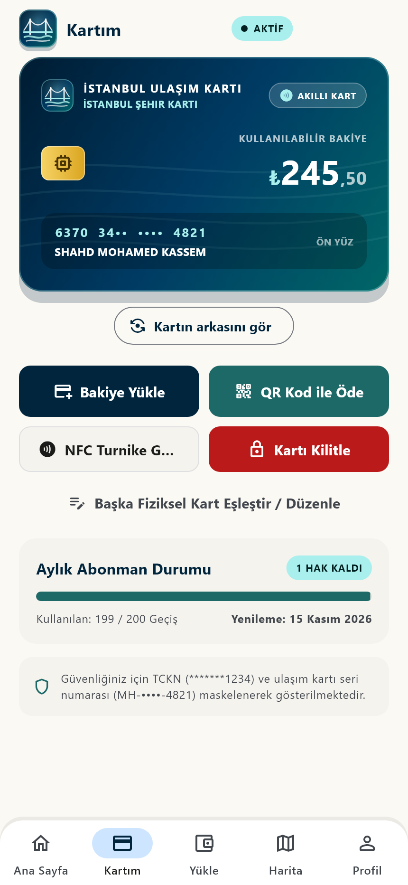
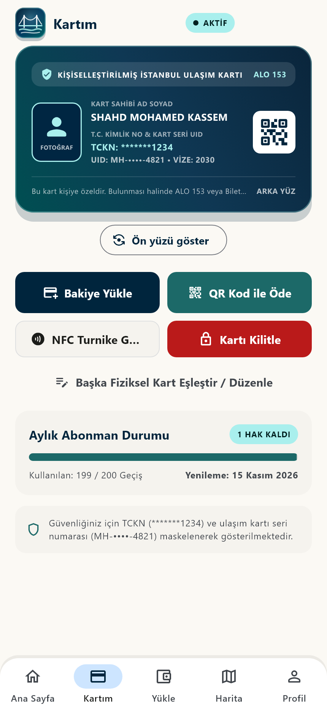
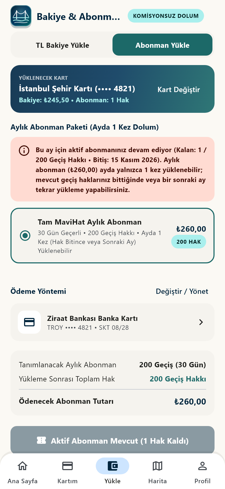
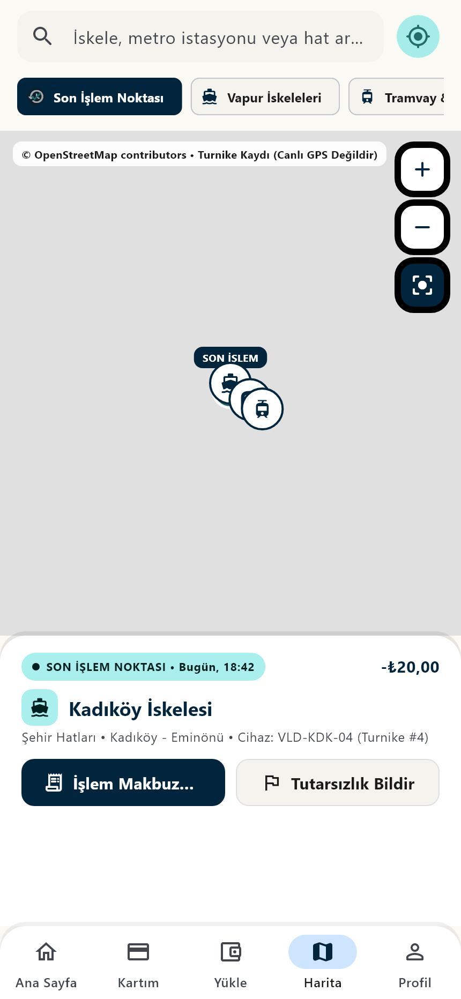
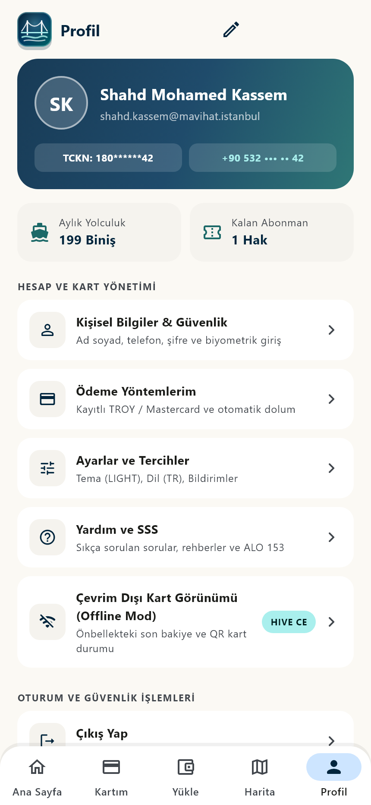

# ⛴️ MaviHat • İstanbul Dijital Ulaşım & Akıllı Şehir Kartı Uygulaması

**MaviHat**, İstanbul’un deniz, raylı sistem (Metro, Tramvay, Tarihi Tünel, Marmaray) ve karayolu (İETT, Metrobüs) ulaşım ağını tek bir modern dijital cüzdanda birleştiren, **Clean Architecture (Temiz Mimari)** prensipleriyle geliştirilmiş çok platformlu (**Android, iOS, Windows, macOS**) bir Flutter uygulamasıdır.

---

## 🎯 Uygulamanın Amacı

Bu projenin temel amacı; İstanbul şehir içi toplu taşıma kullanıcılarının fiziksel ulaşım kartlarını (**İstanbul Ulaşım Kartı**) dijital ortamda güvenle yönetebilmelerini, komisyonsuz TL bakiye ve aylık abonman yükleyebilmelerini, **2 dakikalık (30 saniyede bir yenilenen) dinamik QR kod** veya **aktif NFC temassız geçiş** ile turnikelerden hızlıca geçebilmelerini ve kartlarının son kullanıldığı istasyon/turnike noktasını harita üzerinde takip edebilmelerini sağlamaktır.

Uygulama geliştirilirken **"Sıfır Çalışmayan Buton (Zero Non-Functional UI)"** ve **"Gerçekçi Ulaşım İş Kuralları"** ilkeleri benimsenmiştir:
- **Yeni Açılan Hesaplarda Kart Eşleştirme Zorunluluğu:** Yeni kayıt olan kullanıcılara hazır/sahte kart verilmez; kullanıcı kendi fiziksel ulaşım kartının 16 haneli seri numarasını girerek kartını sisteme eşleştirir.
- **Akıllı Turnike ve Ardışık Basım Algoritması:** Turnike validatörü binilen durağı otomatik algılar. Aynı durakta **1. basımda** aktif aylık abonman hakkı varsa önce abonmandan `1 Hak` düşer; aynı turnikede arka arkaya yapılan **2., 3., 4., 5. basımlarda** (çoklu yolcu geçişi) sistem otomatik olarak sabit `₺20,00` TL bakiye çeker. Farklı bir durağa geçildiğinde sayaç tekrar `1. Basım (Abonman)` olarak sıfırlanır.
- **Aylık Abonman (`₺260,00` • `200 Geçiş`) Kuralı:** Aylık abonman ücreti `₺260,00` olup ayda yalnızca **1 kez** yüklenebilir. Mevcut abonman geçiş hakları ay dolmadan tamamen biterse (`0 Hak`) veya 30 günlük süre dolup bir sonraki aya geçilirse tekrar abonman yüklemesi yapılabilir.
- **Otomatik Bakiye Dolumu:** Turnike geçişi sonrasında kart bakiyesi kullanıcının belirlediği alt limitin (`₺50`, `₺100`, `₺250`) altına düştüğünde kayıtlı banka/kredi kartından otomatik bakiye yükleme talimatı anında tetiklenir.

---

## 📱 Uygulama Ekran Görüntüleri

| Açılış (Splash) & Özel Logo | Ana Sayfa (Dashboard) | Dinamik QR Ödeme (2 Dk / 30 Sn) | Kartım — Ön Yüz (Akıllı Çip) |
| :---: | :---: | :---: | :---: |
|  |  |  |  |

| Kartım — Arka Yüz (Kişisel Kimlik) | Bakiye & Abonman Yükle (`₺260,00`) | Harita & Son İşlem Noktası | Profil & Güvenlik Ayarları |
| :---: | :---: | :---: | :---: |
|  |  |  |  |

---

## 🛠️ Kullanılan Teknolojiler ve Mimari

Projede ölçeklenebilirlik, test edilebilirlik ve katman bağımsızlığı için **Feature-First Clean Architecture (`Domain` → `Data` → `Presentation`)** yapısı uygulanmıştır:

| Kategori | Teknoloji / Paket | Kullanım Amacı |
| :--- | :--- | :--- |
| **Framework & Dil** | **Flutter 3.x & Dart 3.11+** | Android, iOS, Windows ve macOS için tek kod tabanlı (Cross-Platform) uygulama geliştirme |
| **Durum Yönetimi (State Management)** | **`flutter_riverpod`** | Reaktif durum yönetimi, Dependency Injection (Bağımlılık Enjeksiyonu) ve Controller/Notifier akışları |
| **Navigasyon & Yönlendirme** | **`go_router`** | Bildirimsel (Declarative) rota yönetimi, alt sekme kabuğu (`ShellRoute`) ve derin bağlantı desteği |
| **Bulut Altyapısı & Telemetri** | **`firebase_core`**, **`firebase_auth`**, **`cloud_firestore`**, **`firebase_analytics`**, **`firebase_crashlytics`** | Kimlik doğrulama, gerçek zamanlı bulut veri senkronizasyonu, kullanım analitiği ve çökme raporlama (`FirebaseBootstrap` güvenli çevrimdışı yedekleme mimarisiyle) |
| **Yerel Veritabanı (Offline-First)** | **`hive_ce` & `hive_ce_flutter`** | İnternet bağlantısı olmadığında veya yerel oturumlarda kart, bakiye, abonman, işlem geçmişi ve tercihlerin kalıcı olarak saklanması |
| **Harita & Konum Servisleri** | **`flutter_map` & `latlong2`** | OpenStreetMap katmanları üzerinde son turnike işlem noktasının (`Son İşlem Noktası`) ve ulaşım duraklarının türe özel ikonlarla gösterimi |
| **Özel Grafik & Animasyon** | **`CustomPainter` & `Matrix4` 3D Transform** | Vektörel Boğaziçi köprü/dalga logoları, 21x21 dinamik QR matrisi ve 3D dönen İstanbul ulaşım kartı ön/arka yüz tasarımı |
| **Güvenlik & Veri Maskeleme** | **`DataMasker` & `SandboxPaymentGateway`** | TCKN (`*******1234` / `180******42`) ve kredi kartı PAN/CVV verilerinin önbellekte veya arayüzde asla açık metin olarak tutulmaması |

---

## 🧠 Geliştirme Sürecinde En Çok Zorlandığım Kısımlar ve Çözümlerim

1. **Belk Sızıntısı Olmadan 2 Dakikalık & 30 Saniyede Bir Yenilenen Dinamik QR Kod Yönetimi:**
   - **Zorluk:** QR ödeme ekranında hem 2 dakikalık (`120 sn`) toplam oturum süresinin geri sayması, hem her `30 saniyede bir` yeni kriptografik QR tohumunun (`seed`) üretilerek matrisin yeniden çizilmesi, hem de süre `00:00` olduğunda alt pencerenin (`ModalBottomSheet`) kendiliğinden kapanıp `Timer`'ın bellekten temizlenmesi gerekiyordu. Ayrıca widget testlerinde `pumpAndSettle()` kullanıldığında aktif `Timer.periodic` yüzünden sanal saatin ilerlemesi çakışmalara yol açıyordu.
   - **Çözüm:** `QrPaymentSheet` içinde tek bir periyodik zamanlayıcı üzerinden hem toplam süre hem de 30 saniyelik döngü (`_rotationStep`) hesaplandı. Süre bittiğinde veya kullanıcı pencereyi kapattığında `_timer?.cancel()` çağrılarak bellek sızıntısı (memory leak) tamamen engellendi.

2. **Turnikede Otomatik Çoklu Durak Algılama ve Ardışık Basım (`1., 2., 3., 4., 5. Basım`) Mantığı:**
   - **Zorluk:** Gerçek hayatta İstanbulkart ile bir turnikede ilk basımda abonman düşerken, kartınızı yanınızdaki arkadaşlarınıza uzatıp aynı turnikede arka arkaya 2., 3., 4., 5. kez bastığınızda sistemin abonman yerine otomatik olarak TL bakiyeden (`₺20,00`) düşmesi, ancak bir sonraki binişte farklı bir durağa gidildiğinde sayacın tekrar `1. Basım (Abonman)` olarak sıfırlanması gerekiyordu.
   - **Çözüm:** 10 istasyonluk `AutoValidatorTerminal.istanbulNetwork` rotası ve son 15 dakika içindeki istasyon bazlı ardışık işlem sayacı (`tapCountAtStation`) geliştirildi. Böylece kullanıcı her yeni binişte farklı bir durağı otomatik algılar veya `Farklı Durak` butonuyla istasyon değiştirebilir; aynı istasyondaki ardışık basımlar ise hatasız şekilde `1. Basım (Abonman)` → `2., 3., 4., 5. Basım (₺20,00 TL)` kuralını uygular.

3. **Aylık Abonmanın (`₺260,00`) Ayda 1 Kez Yüklenebilmesi ve Hak Bittiğinde Yeniden Açılması:**
   - **Zorluk:** Abonman paketlerinin üst üste sınırsızca (`200` → `400` → `600` hak) eklenmesini önlemek; aktif abonman devam ederken yüklemeyi kilitleyip, yalnızca `200` geçiş hakkı tamamen bittiğinde (`0 Hak`) veya 30 günlük süre dolduğunda yeni yüklemeye izin vermek gerekiyordu.
   - **Çözüm:** `TransitCard` varlığına `hasActiveSubscription`, `isSubscriptionExpired` ve `canLoadSubscription` iş kuralları eklendi. Hem arayüzde (`TopUpScreen`) hem de veri katmanında (`BalanceRepositoryImpl` ve `TransitCardRepositoryImpl`) çift taraflı doğrulama yapılarak mükerrer abonman yüklemesi engellendi.

4. **Kart Tasarımının Banka Kredi Kartı Görünümünden Gerçek İstanbul Ulaşım Kartı Kimliğine Dönüştürülmesi:**
   - **Zorluk:** İlk prototipte kartın arka yüzünde yer alan siyah manyetik şerit ve CVV kutusu kartı bir banka kredi kartına benzetiyordu.
   - **Çözüm:** Kartın ön yüzü Boğaziçi dalga filigranları ve altın ISO akıllı çip ile; arka yüzü ise **Kişiselleştirilmiş İstanbul Ulaşım Kartı** standardına uygun olarak vatandaş fotoğraf alanı, maskeli TCKN (`*******1234`), kart seri UID, DataMatrix doğrulama karekodu ve `ALO 153` bilgisiyle sıfırdan tasarlandı.

5. **Son İşlem Noktasında Ulaşım Türüne Göre Dinamik İkon Eşleştirme ve Çoklu Platform (macOS) Uyumluluğu:**
   - **Zorluk:** Harita ve son işlem kartlarında yalnızca sabit vapur ikonu gösterilmesi, metro/tramvay/otobüs binişlerinde görsel tutarsızlık yaratıyordu. Ayrıca macOS üzerinde App Sandbox varsayılan olarak dış ağ isteklerini engellediği için harita katmanları yüklenemiyordu.
   - **Çözüm:** İşlem kategorisi ve istasyon adına göre (`Vapur`, `Metro & Marmaray`, `Tramvay & Tünel`, `İETT & Metrobüs`) dinamik ikon çözümleyici eklendi. macOS için `DebugProfile.entitlements` ve `Release.entitlements` dosyalarına ağ ve konum izinleri, `MaviHatScrollBehavior` ile de MacBook trackpad/fare sürükleme desteği eklendi.

---

## 🚀 Kurulum ve Çalıştırma

```bash
# 1. Proje dizinine gidin
cd mavi_hat

# 2. Bağımlılıkları yükleyin
flutter pub get

# 3. Uygulamayı istediğiniz platformda çalıştırın
flutter run -d windows   # Windows Masaüstü
flutter run -d macos     # macOS Masaüstü
flutter run -d android   # Android Cihaz / Emülatör
flutter run -d ios       # iOS Simülatör

# 4. Statik analiz ve tüm birim/widget testlerini çalıştırın
flutter analyze
flutter test
```
